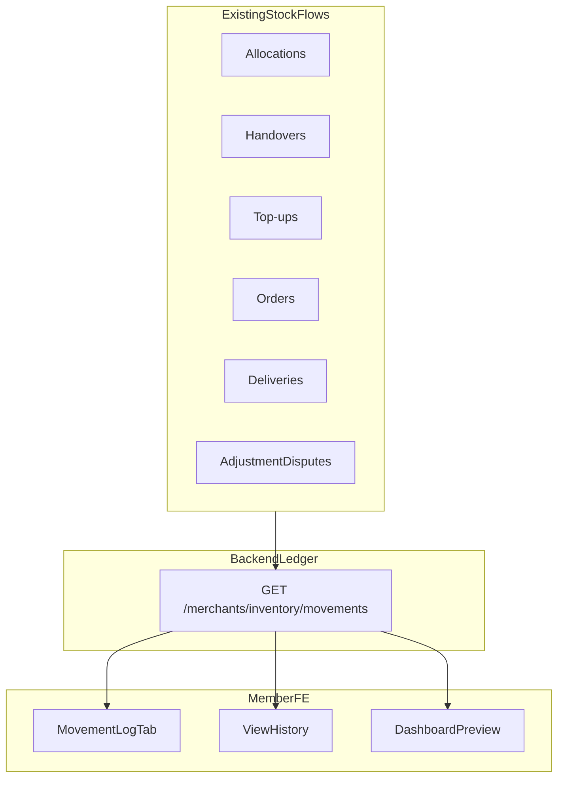

# Frontend Integration — Merchant Inventory Movement Log

**Feature:** Unified stock movement ledger for merchants  
**Status:** Frontend shipped — awaiting `GET /merchants/inventory/movements`  
**Audience:** Member app (merchant dashboard) + backend team  
**Date:** 2026-10-07

**Related docs:**

- [BACKEND_REQUEST_MERCHANT_INVENTORY_MOVEMENTS.md](./BACKEND_REQUEST_MERCHANT_INVENTORY_MOVEMENTS.md) — API contract for backend
- [backend-request-inventory-adjustment-disputes.md](./backend-request-inventory-adjustment-disputes.md) — adjustment disputes + ledger write rules
- [frontend-integration-merchant-stock-dispatch.md](./frontend-integration-merchant-stock-dispatch.md) — allocation dispatch & receipt
- [frontend-integration-merchant-stock-handover.md](./frontend-integration-merchant-stock-handover.md) — M2M handovers
- [frontend-integration-merchant-stock-request.md](./frontend-integration-merchant-stock-request.md) — merchant top-up requests
- [MERCHANTS_API.md](./MERCHANTS_API.md) — merchant endpoint summary

---

## 1. Summary

Merchants need a **single audit trail** for how product units move in and out of inventory — not just current stock levels or delivery totals.

User FE adds:

| Surface | Purpose |
|---------|---------|
| **Inventory → Movement Log** tab | Full filterable ledger with expandable row details |
| **Stock tab → View history** | Per-product drill-down into Movement Log |
| **Dashboard → Recent Stock Movements** | Last 5 entries + link to full log |

Until the backend ships `GET /merchants/inventory/movements`, the UI loads gracefully (empty state + “API not available” banner on 404/501).

---

## 2. Routes & navigation

| Route | Description |
|-------|-------------|
| `/merchant/inventory?tab=movements` | Movement Log tab (default filters) |
| `/merchant/inventory?tab=movements&productId={uuid}` | Movement Log filtered to one product |
| `/merchant/inventory?tab=stock` | Stock levels (with **View history** per row) |
| `/merchant/dashboard` | Recent Stock Movements card |

Side menu: **Merchant Center → Inventory** (unchanged).

---

## 3. Inventory page tabs

The Inventory page now has **four tabs**:

| Tab | Key | Data source |
|-----|-----|-------------|
| Stock | `stock` | `GET /merchants/inventory` |
| Top-ups | `topups` | `GET /merchants/me/stock-requests` |
| Change requests | `disputes` | `GET /merchants/me/inventory-adjustment-disputes` |
| **Movement Log** | `movements` | `GET /merchants/inventory/movements` |

Movement Log is **lazy-loaded** on first tab visit (not on initial page load).

---

## 4. Movement Log UI

### Filters

| Filter | Query param | Notes |
|--------|-------------|-------|
| Product | `productId` | Dropdown from loaded inventory list |
| Type | `movementType` | Allocation, order, restock, adjustment, handover, pending |
| Direction | `direction` | `IN` / `OUT` / `NONE` |
| Date range | `from`, `to` | ISO datetime, optional |
| Reference search | `search` | Order ref, allocation ID, etc. |

**Apply** reloads from offset 0. **Clear** resets all filters and removes `productId` from URL.

### Table columns

| Column | Content |
|--------|---------|
| Date | Localized timestamp |
| Product | Name + SKU |
| Type | Badge (Restock, Delivery, etc.) |
| Change | `+N` green / `−N` red / `—` for pending |
| Balance | `balanceAfter` (authorized qty after event) |
| Reference | Link when resolvable (order, allocation, etc.) |
| Ordered by | Buyer username on outflows |
| Expand | Chevron → metadata panel |

### Expandable metadata

When expanded, rows show:

- Full `description`
- `actor` (MERCHANT / ADMIN / SYSTEM)
- Metadata fields when present: fulfilment method, dispatched/received qty, dispute reason, admin notes, sender merchant, line items

### Pagination

Offset-based **Load more** (50 rows per page). Shows “X of Y entries” when `total` is returned.

---

## 5. Dashboard preview

**Recent Stock Movements** card on `/merchant/dashboard`:

- Loads `GET /merchants/inventory/movements?limit=5&offset=0` when merchant is ACTIVE
- Shows product name, type, description, qty change, relative time
- **View all →** links to `/merchant/inventory?tab=movements`
- Empty / not-available states match Movement Log tab behaviour

Optional future: backend adds `recentMovements[]` to `GET /merchants/dashboard/summary` to avoid a second request.

---

## 6. Service layer

**File:** `src/app/services/merchant.service.ts`

### Types

- `MerchantInventoryMovement`
- `MerchantInventoryMovementType`
- `MerchantInventoryMovementDirection`
- `MerchantInventoryMovementFilters`
- `MerchantInventoryMovementsResponse`

### Methods

| Method | Purpose |
|--------|---------|
| `loadInventoryMovements(filters)` | GET ledger; returns `{ items, total, notAvailable? }` |
| `loadInventoryMovementSummary(productId)` | Optional per-product summary |
| `getInventoryMovementTypeLabel(type)` | Human label |
| `getInventoryMovementBadgeClass(type)` | Tailwind badge classes |
| `formatInventoryMovementDelta(movement)` | `+10`, `−2`, or `—` |
| `resolveMovementReferenceLink(movement)` | Route + queryParams for deep links |

### Reference link targets

| `referenceType` | Navigation |
|-----------------|------------|
| `ORDER` | `/merchant/orders/:id` |
| `ALLOCATION` | `/merchant/allocations` |
| `HANDOVER` | `/merchant/handovers` |
| `STOCK_REQUEST` | `/merchant/inventory?tab=topups` |
| `INVENTORY_ADJUSTMENT_DISPUTE` / `DISPUTE` | `/merchant/inventory?tab=disputes` |

### Error handling

| HTTP status | FE behaviour |
|-------------|--------------|
| 200 | Render table |
| 404 / 501 | `notAvailable: true` — banner “API not available yet” |
| Other | Error message + Retry |

---

## 7. Expected movement types (backend)

### Stock in (`direction: IN`)

- `ALLOCATION_RECEIVED`
- `HANDOVER_RECEIVED`
- `RESTOCK_APPROVED`
- `ADJUSTMENT_APPROVED_INCREASE`

### Stock out (`direction: OUT`)

- `ORDER_ASSIGNED`
- `ORDER_PICKUP_CONFIRMED`
- `ORDER_DELIVERY_CONFIRMED`
- `ADJUSTMENT_APPROVED_DECREASE`

### Pending / audit (`direction: NONE`, delta 0)

- `RESTOCK_REQUESTED`
- `ADJUSTMENT_SUBMITTED`
- `ALLOCATION_DISPUTED`
- `HANDOVER_PENDING`
- `HANDOVER_REJECTED`

Full API contract: [BACKEND_REQUEST_MERCHANT_INVENTORY_MOVEMENTS.md](./BACKEND_REQUEST_MERCHANT_INVENTORY_MOVEMENTS.md).

---

## 8. Key files

| File | Role |
|------|------|
| `src/app/services/merchant.service.ts` | Types, API call, labels, link resolver |
| `src/app/services/merchant.service.spec.ts` | Mapping, 404 handling, link resolver tests |
| `src/app/pages/merchant/merchant-inventory/merchant-inventory.component.ts` | Tab state, filters, pagination |
| `src/app/pages/merchant/merchant-inventory/merchant-inventory.component.html` | Movement Log tab + View history buttons |
| `src/app/pages/merchant/merchant-dashboard/merchant-dashboard.component.ts` | Recent movements loader |
| `src/app/pages/merchant/merchant-dashboard/merchant-dashboard.component.html` | Recent Stock Movements card |

---

## 9. Manual test checklist

### Movement Log tab

- [ ] Open Inventory → Movement Log; tab loads without error when API returns 404 (shows coming-soon banner)
- [ ] With API data: table shows date, product, type, change, balance, reference, ordered by
- [ ] Expand row shows description, actor, metadata
- [ ] Product filter narrows results
- [ ] Type / direction filters work
- [ ] Date range + Apply reloads data
- [ ] Reference search filters correctly
- [ ] Load more appends next page
- [ ] Reference link on ORDER row opens order detail

### Stock drill-down

- [ ] **View history** on desktop table row → Movement Log tab with `productId` in URL and filter applied
- [ ] **View history** on mobile card → same behaviour

### Dashboard

- [ ] ACTIVE merchant sees Recent Stock Movements card
- [ ] **View all →** opens Movement Log tab
- [ ] Empty / not-available states render correctly

---

## 10. Out of scope (this release)

- CSV export
- Admin-side movement viewer (see [BACKEND_REQUEST_MERCHANT_INVENTORY_AND_ADMIN_STOCK.md](./BACKEND_REQUEST_MERCHANT_INVENTORY_AND_ADMIN_STOCK.md))
- Client-side stitching from orders/deliveries/allocations APIs (ledger must be backend-authoritative)
